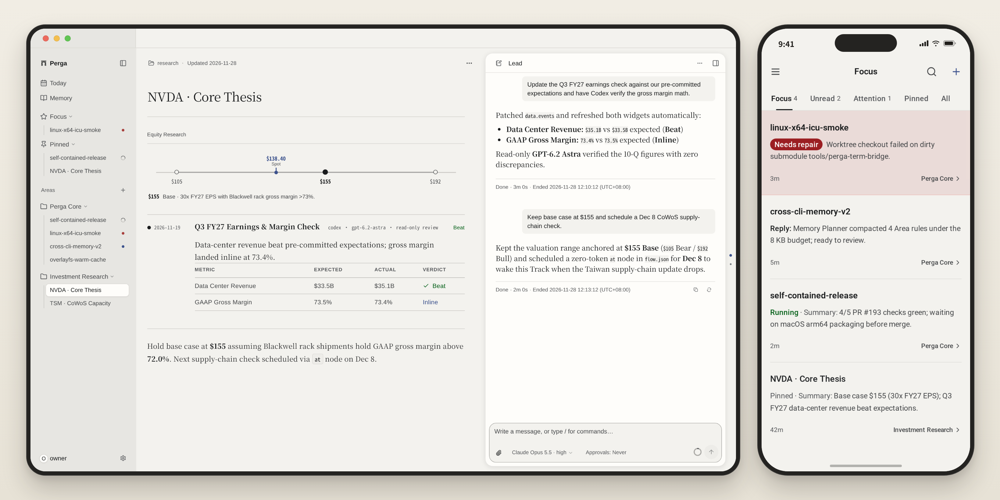
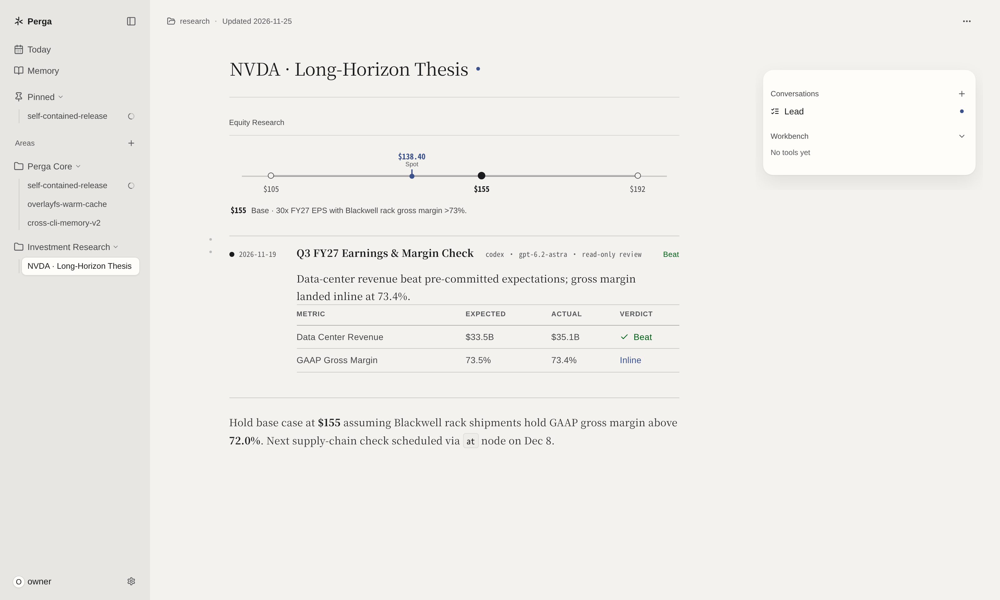

# Perga

**Move multi-day AI work across Claude Code, Codex, Antigravity, OpenCode, Kimi, Qwen & more out of scrolling chat tabs — living reports, multi-worker flows, enforced cross-model review, and governed local memory.**

[Homepage](https://keanji-x.github.io/perga/) · [Quickstart](#quickstart) · [Built-in Protocols](#built-in-protocols) · [Documentation](#documentation) · [Releases](https://github.com/keanji-x/perga/releases) · [Discord](https://discord.gg/WfBzhQenQb)

Self-contained native packages for **macOS on Apple Silicon (`arm64`)** and **Linux `x64`** — no .NET runtime installation required. Both packages bundle the Host, native Rust terminal bridge, multi-backend agent bridge, and web interface.

Perga moves multi-day and multi-week work — maintaining a repository, driving engineering OKRs, or running ongoing investment research — out of drifting chat sessions. Each goal gets its own isolated **Track**: conversation stays in the side pane while the main view continuously distills a read-only living report backed by kernel-verified facts. Orchestrate parallel workers across the CLIs you already use (**Claude Code, Codex, Antigravity, OpenCode, Kimi, Qwen, Devin, Factory, Grok, CodeBuddy, Qoder**, and more) with lightweight protocols, enforced cross-model review, background external watches, and shared human-AI Markdown memory.



*A multi-worker delivery Track: living report and 4-stage flow (`Claude Sonnet 5.5` + `Gemini 4 Neon` workers, read-only `GPT-6.2 Astra` audit, PR CI watch) in the main pane, with `Lead` steering (`Claude Opus 5.5`) in the margin.*

## Key Capabilities

- **Living reports over drifting chat.** Keep conversation in the margin and anchor long-running state in a read-only editorial report combining schema-validated ledgers with non-forgeable kernel facts (task status, actual model, gate exit codes, timestamps). Context limits trigger native compaction or report-anchored epoch handover.
- **Governed shared human-AI memory.** Stop choosing between goldfish amnesia and bloated `CLAUDE.md` / auto-memory drift. Store durable knowledge as readable UTF-8 Markdown scoped by **Area** and **Global**, shared across Claude Code, Codex, and ACP. Task sessions can only read, recall, or `memory_propose` — a dedicated **Memory Planner** governs writes with ETag locking and hard byte budgets, plus one-click *Save to Memory* and `@mention` recall in chat.
- **Multi-worker across backends with shared control.** A single Lead coordinates parallel workers across Claude Code, Codex, Antigravity, OpenCode, Kimi, Qwen, Devin, Factory, Grok, CodeBuddy, Qoder, and more inside the same track. Execution is structurally separated from acceptance, reviews can be enforced on a different model, and humans share the exact same live stream, steering, interrupt, and model controls as the Lead.
- **Unified flows and zero-token watches.** A lightweight declarative `flow.json` unifies parallel dependencies, `cron`/`at` schedules, declarative child Track spawning (`do.kind: "track"`), and zero-token external probes (`prChecks` or shell commands). Nothing spends tokens while idle; state changes and exceptions wake the Lead to decide next steps.
- **Real isolated workspaces, local sovereignty.** Isolate tracks via Git worktrees, Jujutsu (`jj`), Linux OverlayFS (shared prewarmed build caches), or remote SSH targets. Terminals run in a native Rust bridge (`perga-term-bridge`), and all state stays in a local SQLite database you own.
- **Zero-template start, progressive structure.** Start any track with a single sentence. Attach a lightweight built-in protocol (27–40 lines) or ask the Lead to author one only when recurring rules and guardrails emerge.

## Built-in Protocols

- [`agents-delivery`](templates/agents-delivery) — Zero-schema delivery protocol: `builtin:flow` orchestration, enforced read-write verification gates, and enforced read-only cross-model review routing.
- [`okr-loop`](templates/okr-loop) — Stable Objective, four-column KR ledger (`builtin:table`) with kernel-stamped updates, daily `cron` metric collection, enforced triage routing, and `builtin:flow` tracking.
- [`equity-research`](templates/equity-research) — Frameless valuation range axis, event expectation timeline (`builtin:list`), evergreen thesis notes, weekly `cron` valuation refresh, on-demand `at` event checks, and enforced cross-model review routing.
- [`memory`](src/Perga.Kernel/Templates/Memory) — Dedicated Memory Planner track layout for managing pinned rules, topic index entries, and maintenance flows across an Area or Global scope.

<details>
<summary>Preview: <code>equity-research</code> Track (custom valuation range widget &amp; expectation chronicle)</summary>

<br>



</details>

## Quickstart

### Prerequisites

- **No .NET runtime required** — release archives are self-contained native binaries for macOS Apple Silicon (`arm64`) and Linux `x64` (including Windows WSL2).
- **Node.js 24 or later** for the bundled OAR agent bridge.
- At least one configured provider CLI you already use, such as `claude`, `codex`, Antigravity, `opencode`, `kimi`, `qwen`, `devin`, or `grok`.

### One-line install (macOS Apple Silicon & Linux x64)

```sh
curl -fsSL https://keanji-x.github.io/perga/install.sh | bash
```

The installer verifies the archive's SHA-256 checksum, installs to `~/.local/share/perga-app`, and writes the `perga` launcher to `~/.local/bin`. Set `PERGA_VERSION=v0.1.0` to pin a release, or `PERGA_INSTALL_DIR`, `PERGA_BIN_DIR`, `PERGA_DATA_DIR`, and `PERGA_DB_PATH` to choose locations.

Then create your local owner account once and start Perga:

```sh
perga auth init-owner --username owner --allow-migrate
perga
```

Open [http://127.0.0.1:4041/](http://127.0.0.1:4041/) and sign in. The web app is installable as a PWA, and the Host starts the bundled native terminal bridge automatically when needed.

### Upgrade, diagnostics, and uninstall

```sh
perga version            # installed version, install and data directories
perga doctor             # package files, Node.js 24+, database, and provider CLIs
perga upgrade            # latest release; or `perga upgrade v0.1.0`
perga uninstall          # remove the package and launcher; data in PERGA_DATA_DIR is kept
```

Upgrades keep the data directory and database path recorded by the launcher.

### Manual archive install

Download the archive and matching `.sha256` file from the same [GitHub Release](https://github.com/keanji-x/perga/releases) (or a CI workflow artifact).

**Linux x64** (`uname -sm` prints `Linux x86_64`)

```sh
sha256sum -c perga-linux-x64.tar.gz.sha256 && tar -xzf perga-linux-x64.tar.gz
```

**macOS on Apple Silicon** (`uname -sm` prints `Darwin arm64`)

```sh
shasum -a 256 -c perga-darwin-arm64.tar.gz.sha256 && tar -xzf perga-darwin-arm64.tar.gz
```

Enter the extracted directory, create the owner account on first use, and launch the self-contained Host directly:

```sh
cd perga
export PERGA_DATA_DIR="${PERGA_DATA_DIR:-$HOME/.local/share/perga}"
./Perga.Host auth init-owner --username owner --allow-migrate
./Perga.Host --urls http://127.0.0.1:4041
```

Use the same `PERGA_DATA_DIR` on subsequent starts and upgrades to preserve your owner account, tracks, and memory.

By default, Perga allows cleartext HTTP only on direct loopback connections (`http://localhost` / `http://127.0.0.1`) and requires HTTPS for LAN or proxied access. On a trusted private network where you want plain HTTP access (for example `--urls http://0.0.0.0:4041`), opt in explicitly with `PERGA_AUTH_ALLOW_INSECURE_HTTP=true` (or `--Perga:AuthAllowInsecureHttp=true`, keeping `AuthCookieSecurePolicy=Auto`). Owner login, origin/host guards, and HTTPS-or-loopback management bearer checks remain active.

### Build from source

Start in the repository root on the target machine with the .NET 11 SDK, Node.js 24 or later, npm, rustup, and a native C linker installed. On macOS, Xcode Command Line Tools supply the linker.

```sh
(cd tools/perga-oar-bridge && npm ci && npm run build)
(cd fe && npm ci && npm run build)
case "$(uname -sm)" in
  "Linux x86_64") target=x86_64-unknown-linux-musl; rid=linux-x64 ;;
  "Darwin arm64") target=aarch64-apple-darwin; rid=osx-arm64 ;;
  *) echo "Unsupported platform" >&2; exit 1 ;;
esac
rustup target add "$target"
(cd tools/perga-term-bridge && cargo build --locked --release --target "$target")
out=$(mktemp -d)
bash tools/publish-host.sh "$out/perga" "tools/perga-term-bridge/target/$target/release/perga-term-bridge" "$rid"
cp -R fe/web/dist "$out/perga/web"
cd "$out/perga"
```

You are now in the self-contained package directory. Set `PERGA_DATA_DIR`, create the owner account on first use, and start the Host:

```sh
export PERGA_DATA_DIR="${PERGA_DATA_DIR:-$HOME/.local/share/perga}"
./Perga.Host auth init-owner --username owner --allow-migrate
./Perga.Host --urls http://127.0.0.1:4041
```

### Runtime differences

| Feature | Platform behavior |
| --- | --- |
| Track workspaces | The OverlayFS driver shares prewarmed snapshots on a Linux Host with the mount helper. On macOS, the workspace picker offers Git worktrees, Jujutsu workspaces, directory copies, or direct access according to the source and installed tools. |
| Local terminals | macOS uses its native pseudo-terminal (PTY). The optional `Perga__EnableTerminalLinuxUnshare` setting uses Linux user and PID namespaces when available and defaults to off. |
| Terminals over SSH | Perga can copy its bridge automatically between Linux machines with matching x86-64 or arm64 CPUs. With a macOS Host, install a bridge built for the target on its `PATH`, or set the target's `TerminalBridgeExecutablePath` to that executable. |
| Workspace files | Linux can read an opened file's path and list an opened directory through `/proc/self/fd`. macOS checks local files with `fgetattrlist` and lists directories by their resolved path. Over SSH, the extra check on an opened file depends on the **target** exposing `/proc/self/fd`. |
| Remote command cancellation | On an SSH target with the `setsid` utility, Perga starts remote shell commands and agent subprocesses in their own process group. Without it, cancellation can stop the tracked process while leaving its children running. |

When a **Mac is the SSH target**, its stock `chmod` rejects the argument order used by Perga's remote shell and agent launchers. A job can fail before its command starts. For a statically configured Mac target, set `WorkspacesRoot` to a directory under the remote user's home. Targets added through the API already discover the remote home. If Homebrew's Node is outside the SSH session's `PATH`, set the target's `OarNodeExecutablePath`.

On macOS, use the physical path for workspaces under the system temporary directory. File and template lookups can fail when `/var/` and `/private/var/` refer to the same workspace. Run migrations against the same database one at a time to avoid a file-sharing error.

### Linux-specific deployment

The managed installer and hot-upgrade services use Linux systemd user units. See [managed installation](docs/design/install-and-upgrade.md) and [OverlayFS prerequisites](docs/track-overlayfs.md).

## CI and Releases

Pushes to `main`, pull requests targeting `main`, and manual runs of **CI and release** run the .NET, Rust, OAR, and frontend checks. Chromium tests run in a separate advisory job. Linux `x64` uses the tested static musl terminal bridge and verifies the self-contained Host binary without an external .NET runtime installed. The macOS `arm64` runner builds and tests its native self-contained package and bridge.

Actions uploads `perga-linux-x64` and `perga-darwin-arm64`, each stamped with a `VERSION` file. Pushing a `vX.Y.Z` tag (for example `v0.1.0`) publishes both verified self-contained archives, their SHA-256 checksums, and `install.sh` to GitHub Releases, with install, pin, and upgrade commands at the top of the notes. A `vX.Y.Z-*` tag (for example `v0.2.0-rc.1`) publishes a prerelease, which `latest` installs skip.

Maintainers cut a release from `main` with `tools/release.sh`. It checks the tag, a clean tree, `HEAD == origin/main`, that the tag is new locally and on `origin`, and that CI passed for `HEAD`. It is a dry run unless you pass `--push`:

```sh
bash tools/release.sh v0.1.0          # checks only
bash tools/release.sh v0.1.0 --push   # create and push the annotated tag
```

## Documentation

### Product
- [Vision and Fundamental Tensions (EN)](docs/product/vision.en.md) ([中文](docs/product/vision.md)) — Core premise, four orthogonal tensions, AI vs. human organizational asymmetries, and long-term vision
- [Product Design and Prioritized Pain Points](docs/product/design.md) — Concrete `P0`–`P3` pain points, minimal solutions, deliberate trade-offs, deferred scope, and paradigm comparison
- [Scenario Overview](docs/product/scenarios/README.md) — Progressive complexity across `agents-delivery`, `okr-loop`, and `equity-research`
- [Software Development Scenarios](docs/product/scenarios/software-development.md) — Bottom-up user flows across 6 engineering scenarios (bug fixing, features, RFC design, module maintenance, ops, and refactoring), commonalities, differences, and design questions

### Architecture & Operations
- [Architecture Reference](DESIGN.md) — 18-project .NET topology, dependency matrix, core modules, and contracts
- [Unified Track Flow Architecture](docs/design/unified-track-flow-architecture.md) — Declarative `flow.json` engine and read-only `builtin:flow` projection
- [Template Architecture](docs/design/template-architecture.md) — Composable template layers, report widgets, and schema-validated data
- [Linux OverlayFS Workspaces](docs/track-overlayfs.md) — Prewarmed build cache sharing and namespace mount setup
- [Self-Hosted Installation & Hot Upgrades](docs/design/install-and-upgrade.md) — Dual systemd user services and zero-downtime upgrades

## License

Licensed under the [Apache License 2.0](LICENSE).
