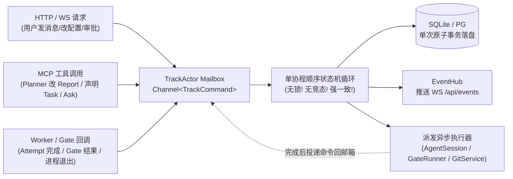

# Neige Rust 后端预调研与 C# (.NET) 从零重设计方案

> **调研基线**：直接阅读审计当前工作区 28 个 Rust crate 与插件源码（生产代码 **~44.2 万行**，测试代码 **~55.5 万行**，SQLite 迁移 **221 个文件 / 10,009 行 SQL / 83 张现存表**）。

---

## 一、现状全景体检：为什么会有 44 万行生产代码且 Bug 频发？

当前后端的核心业务本质其实非常清晰：**围绕 `Area -> Track -> Report(含 Task) + Conversation(Planner/Assistant) + Worker/Gate/Git` 的多智能体研发与投研协作内核**。但代码膨胀了 **10~15 倍**，根源在于以下 **6 大结构性病灶**：

### 1. 多代架构原位叠床架屋（V1 `historical`/`retained` 与 V2 `canonical` 双轨并存）
源码中大量模块同时保留了新旧两套（甚至三套）数据模型、路由和状态机，靠运行时条件分支防串台：
- **对话存储双轨制**：SQLite 中既有旧版 `harness_items` + `worker_sessions.handle_state_json`（整包 JSON 快照覆盖）+ `planner_input_idempotency`，又有新版 V2 `canonical` 家族 10+ 张表（`conversation_messages`、`conversation_message_revisions`、`conversation_turns`、`conversation_input_submissions`、`conversation_presentations` 等）。`crates/calm-server/src/harness/mod.rs:197-203` 甚至必须在启动恢复时调用 `has_canonical_storage()` 显式跳过旧路径。
- **启动适配器三轨分支**：`crates/calm-server/src/operation/planner_harness_start_adapter.rs` 单文件 **3,565 行**，内部同时挂载 `canonical`、`historical`、`retained` 三个子模块。
- **HTTP 路由双轨制**：`crates/calm-server/src/routes/`（55 个路由模块，生产代码 ~2.5 万行 + 内嵌 `canonical_flow_tests` ~3.8 万行）同时保留了 `planner_cards` / `planner_input*` / `claude_cards` / `codex_cards` / `harness_live` 等旧端点，以及 `conversation_read` / `conversation_items` / `conversation_run` / `conversation_pending` / `track_conversations/canonical` 等新端点；`tracks/create/` 下同时躺着 `creation_plan.rs`、`dormant.rs` 与 `historical_plan.rs`。
- **历史命名与字段兼容散落全局**：
  - 数据库从早期 `coves` / `waves` 一路改名和追加了 **221 个迁移文件**，累计建表 111 张、现存 **83 张表**。
  - `Track` 结构体（`crates/calm-types/src/model.rs:249-299`）至今保留 `#[serde(alias = "workflow_id")]`、`workflow_input`、`cwd_wire_alias`、已退役的 `AREA_CHAT_PURPOSE = "area-chat"` 过滤；`SharedCodexDaemonRecord` 甚至保留 `paths_are_legacy_display: bool` 兼容旧编码；`neige-app/src/supervisor.rs:79` 仍在同时传递旧前端 `CALM_WEB_DIST` 与新前端 `CALM_FE_DIST`。

### 2. 权限门禁三代叠压 + 缓存回滚漂移补丁（4,008 行只做鉴权）
- `crates/calm-truth/src/role_gate.rs`（2,342 行）+ `decision_gate.rs`（1,666 行）合计 **4,008 行**。
- `ActorId` 叠加了三代身份：Header 裸传卡 ID（`AiCodex`/`AiClaude`/`AiPlanner`）、会话 ID（`Ai*Session`）、托管助手（`AiManagedSession`/`AiManagedCard`）。
- **典型补丁反模式**（`decision_gate.rs:189-200`）：早期设计了全局内存穿透缓存 `CardRoleCache` 与 `TrackAreaCache`，并一路塞进 `AppState`、`RouteState`、`WriteContext` 和所有 `_tx` 函数签名；后来发现 **SQLite 事务回滚会导致内存缓存与数据库状态双向漂移**，却没有删掉这套缓存，而是在每次写事务里查库临时 `new` 两个一次性 `CardRoleCache` 喂给旧函数！

### 3. 五层异步编排状态机套娃（~12.5 万行）
本来是一个线性的任务生命周期，在 `calm-server` 里被拆成了 5 层各自持久化的子系统：
1. **`task_projection.rs`（2,935 行）**：从 Report Block 投影 `tasks` 表。因 crate 依赖限制，连 `live_declaration_blocks_by_key` 都在 `calm-truth` 和 `calm-server` 各抄写了一遍（见 `task_projection.rs:221-224` 注释），还用 13 元匿名 Tuple 对比字段漂移。
2. **`Scheduler`（4,877 行）**：轮询/事件触发扫表，为了不破坏旧版在途任务的 `stable_payload_hash`，连 `task.cwd` 都不敢序列化进 Worker Payload（见 `scheduler/mod.rs:179-181`）。
3. **`OperationRuntime` + 19 种 `ProviderAdapter`（53,892 行）**：把所有动作（建卡、启停 Planner、跑 Worker、跑 Gate、建子 Track、Git 动作）强行塞进一套 6 阶段持久化 Saga（`Pending -> TxCommitted -> AppServerInteract -> SpawnStarted -> SpawnSucceeded -> Succeeded` + 版本化逆向补偿 `CompensationStateVersioned` + 60 秒租约）。
4. **`Dispatcher`（4,998 行）**：在 60 种 `Event` 枚举上做复杂的唤醒资格矩阵判定与启动追赶（`PLANNER_CATCH_UP_KINDS`）。
5. **`PlannerHarness`（56,022 行）**：自维护内存消息队列、折叠规则、重放水位线、自压缩状态机。

### 4. 并发锁地狱与 SQLite 单写锁风暴（高发 Bug 的直接根源）
- **9+ 把内存锁人工排锁序**：仅 `crates/calm-server/src/state.rs:119-162` 就在 `RouteState` 上挂了 7 张独立内存锁表（`planner_recovery_locks`、`conversation_first_message_locks`、`track_delete_locks`、`planner_attachment_locks`、`planner_input_key_locks`、`thread_seals`、`area_delete_locks`），外加 `OperationRuntime.drive_mutex`、`PlannerHarnessStartAdapter.per_card_mint_locks`、`pending_codex_threads_spawn_serial`。源码注释写了整整 20 行锁顺序规则来人肉防死锁。
- **跨表状态撕裂与抢锁**：同一任务的真实状态分散在 `tasks`、`operations`、`worker_sessions`、`terminals`、`workspace_leases`、`task_git_deliveries`、`events` 7 张表里；后台 Reaper、Scheduler、OperationDriver、BootReconcile 并发抢 SQLite 写锁，`calm-server/src/lib.rs:186` 甚至靠字符串匹配 `"database is locked"` 做退避重试。
- 测试目录中动辄三五千行的测试（`scheduler.rs` 9,993 行、`no_double_spawn.rs` 3,475 行、`planner_harness_boot_recovery.rs` 3,039 行）以及混在生产代码里的 `PlannerHarnessDrainRaceHook`，本质上都是在给这套多锁多表状态机堵漏。

### 5. 多 Agent 运行时重复造轮子（~4.5 万行）
- Codex、Claude、ACP（Antigravity / OpenCode / Grok）分散在 `crates/provider`（10k）、`shared_codex_appserver`（11.9k）、`acp_planner`（13.2k）、`claude_planner`（8.4k）、`claude_worker`（1.7k）、`worker_flow`（4.2k）、`calm-codex-bridge`（0.9k）中，各自独立管理子进程、JSON-RPC、审批挂起、中断与流归一化。
- 为了让子进程调内核工具，专门写了 `neige-mcp-stdio-shim`（1.4k）把 stdio 桥接到内核 UDS，再由手写的 `mcp_server/`（2.1 万行，内含一套手搓 CLI 解析器 `mcp_server/cli/`）处理；甚至还有 `/tmp/neige-hook-fallback` 落盘 JSON 再 HTTP 回环 POST 的补丁链路（`calm-server/src/lib.rs:293-400`）。

### 6. 过度工程化的自研基础设施（`track_vcs` + 跨进程插件宿主）
- **SQLite 内手搓 Git 对象库（`calm-truth/src/track_vcs`，~5,000 行）**：为了存 Report 和对话历史，自己实现了 `objects/commits/refs`、Delta 差分编码、压缩与三阶段标记清除 GC（`track_vcs_gc_*`）。
- **重型插件隔离（`crates/plugin` 2.3 万行 + `plugins/*` 1.9 万行）**：`git-forge`、`calendar`、`market`、`barra`、`research-archive` 等内部一等业务能力，走了 3,896 行的 `manifest.rs` Schema 校验、跨进程 MCP 守护、崩溃计数窗口与 Token 鉴权。

---

## 二、代码体量对比：Rust 现状 vs C# 重写目标预估

| 子系统 | Rust 现状生产代码 | 核心病灶 | C# (.NET 9/10) 重设计目标 | 压缩原因 |
| :--- | ---: | :--- | ---: | :--- |
| 领域模型与存储层 | ~80,500 行 (`calm-truth` + `calm-types`) | 83 张表、221 迁移、4k 行鉴权门禁、5k 行自研 `track_vcs` | **~3,500 行** | 收敛为 **14 张表** + EF Core / Dapper；Zstd 修订快照表替代 `track_vcs`；中间件鉴权 |
| 编排与调度内核 | ~125,000 行 (`harness` + `operation` + `scheduler` + `dispatcher`) | V1/V2 并存、19 种 6 阶段 Saga、9 把内存锁 | **~3,000 行** | **单 `TrackActor` (`Channel<T>`) 串行状态机**，消灭多表分裂与锁序地狱 |
| Agent 运行时适配 | ~45,000 行 (`provider` + `*_planner` + `shared_codex` + `worker_flow`) | 3 套协议栈重复实现进程与流控 | **~3,000 行** | 统一 `IAgentDriver` / `IAgentSession`（Codex / Claude stream-json / ACP 3 个实现类） |
| HTTP / WS / MCP 接口 | ~48,000 行 (`routes` + `ws` + `mcp_server` + `shim`) | 新旧路由双份、手搓 MCP 协议栈与 UDS shim | **~3,500 行** | ASP.NET Core Minimal APIs + 官方 `ModelContextProtocol` C# SDK（原生 Streamable HTTP MCP） |
| 模块/插件与 Git 交付 | ~45,000 行 (`plugin` + `git_candidate` + 内部插件) | 内部模块全走跨进程 IPC 与重型 Manifest | **~3,500 行** | 内部能力改为进程内 `INeigeModule`；外部扩展直接挂标准 MCP Client |
| 进程/终端/浏览器配套 | ~30,000 行 (`neige-app` + `proc-supervisor` + `chrome-control` 等) | 多层守护进程树、手写 CDP 客户端 | **~2,000 行** | 单主进程宿主 + Playwright.NET + 轻量 PTY 管理（桌面合成器按需外挂） |
| **合计（生产代码）** | **~442,000 行** | — | **~18,500 ~ 25,000 行** | **砍掉 >94% 胶水、兼容与重复状态机代码** |

---

## 三、C# (.NET 9 / .NET 10) 从头架构设计

### 1. 技术栈选型（成熟、极简、高性能）
- **运行时与 Web 框架**：**.NET 9 / .NET 10 + ASP.NET Core Minimal APIs**（AOT 友好或常规 Tiered JIT，单进程高并发，内置 `System.Text.Json` Source Generator 与 OpenAPI 生成）。
- **并发与编排核心**：标准库 **`System.Threading.Channels`**（无需上重型分布式 Actor 框架，200 行即可实现按 `TrackId` 分片的内存 Actor 邮箱与空闲卸载）。
- **MCP 协议层**：官方 **`ModelContextProtocol.AspNetCore` NuGet 包** —— 用 Attribute 直接暴露工具，原生支持 **Streamable HTTP / SSE**，Agent 子进程直接配一个 HTTP URL + Bearer Token 即可连入，**彻底淘汰 `neige-mcp-stdio-shim` 和 UDS 转发**。
- **数据访问**：
  - 单机部署：**SQLite（开启 `WAL` + `synchronous=NORMAL` + 单写者连接或连接池忙等待）+ EF Core / Dapper**；
  - 若有团队多人共享诉求：直接上 **PostgreSQL（`Npgsql` + `jsonb`）**，彻底根除 SQLite 单写锁竞争。
- **浏览器与终端**：`Microsoft.Playwright`（替代 `chrome-control`）；PTY 采用轻量 Linux `forkpty` P/Invoke 封装（或复用独立小进程保持热重启不断连）。

### 2. 解决方案（Solution）模块划分（仅 5 个核心 Project，严禁循环与过度切碎）

```text
src/
├── Neige.Contracts/          # 纯 DTO、领域枚举、事件协议、JSON Schema（零外部依赖，可生成 TS 类型给 fe/）
├── Neige.Core/               # 领域模型、TrackActor 状态机、Report 引擎、Task 调度与 Git Worktree 服务、接口定义
├── Neige.Infrastructure/     # SQLite/PG 存储实现、Codex/Claude/ACP 三大 AgentDriver、PTY 终端管理、Git/GitHub CLI 执行器
├── Neige.Modules/            # 进程内一等业务模块：GitForge、Calendar、Market、Barra、ResearchArchive（实现 INeigeModule）
└── Neige.Server/             # ASP.NET Core 入口：REST 路由、WebSocket /api/events 推送、MCP HTTP Endpoint、鉴权中间件
```

### 3. 核心架构支柱一：`TrackActor` 单写者模型（根治竞态、死锁与双发）

Neige 99% 的状态变更都局限在**单个 Track 内部**。旧架构之所以要 9 把锁和 6 阶段 Saga，是因为 HTTP 请求协程、MCP 工具协程、后台 Scheduler 协程、Reaper 协程都在同时读写同一个 Track 的数据库行。

**新设计：每个活跃 `Track` 在内存中只有一个 `TrackActor` 实例，拥有唯一串行邮箱 `Channel<TrackCommand>`**：



**带来的质变**：
1. **零内存锁死锁风险**：同一个 Track 内，用户点击删除 Track、Planner 提交 `neige_report_commit`、Worker 刚好跑完汇报、Scheduler 准备拉起下一个任务——全部在 `Mailbox` 里排队顺序执行，**根本不可能发生 `no_double_spawn` 或删除半截漏出僵尸会话**。
2. **状态内存常驻 + 落盘即投影**：活跃 Track 的当前 `Report`、`Tasks` DAG、活跃 `Conversation` 状态直接驻留在 `TrackActor` 内存中；收到命令 -> 内存校验不变量 -> 1 次 DB 事务写主表与 `events` 表 -> 触发异步副作用（通过 `CancellationToken` 管控生命周期）。空闲 10 分钟无活跃任务的 `TrackActor` 自动从字典卸载释放内存。
3. **极简崩溃恢复（50 行代码替代 5.4 万行 `OperationRuntime`）**：
   服务重启启动时，只需扫描 `tasks WHERE status IN ('Running', 'Verifying')`：将未完成的执行标记为 `Failed(InterruptedByRestart)`，清理对应 Worktree 锁，并往对应 `Track` 写入一条待处理的 Planner 唤醒事件。无需任何跨重启半成品 Saga 恢复！

### 4. 核心架构支柱二：极简数据库设计（从 83 张表收敛到 14 张表）

彻底废除双轨表、`operations` 表和 `track_vcs_*` 六张表，收敛为正交的 **14 张核心表**：

1. **`areas`**：`id, name, color, kind, default_template_id, default_cwd, folders_json, sort, created_at, updated_at`
2. **`tracks`**：`id, area_id, parent_track_id, parent_attempt_id, title, closed_at, workspace_kind, workspace_path, worktree_path, branch_name, template_id, sort, created_at, updated_at`
3. **`reports`**：`track_id (PK), doc_rev, summary, contract_json, blocks_json, updated_at`
   - *说明*：一份 Report 通常只有几十个 Block（几 KB ~ 几十 KB），当前态直接存结构化 `blocks_json`（含 `id, rev, kind, content/payload`），`TrackActor` 在内存中直接做行级/块级 Anchor 校验与 Merge，速度快 100 倍且无需多表 Join。
4. **`report_revisions`**：`track_id, doc_rev (PK), author, message, blocks_zstd (BLOB), created_at`
   - *说明*：每次提交追加一行 Zstd 压缩后的快照（单次仅数 KB），**1 张表 + 30 行代码直接替代 5,000 行 `track_vcs` 自研对象库与 GC**！
5. **`tasks`**：`id, track_id, block_id, key, generation, kind, access, ready, depends_on_json, goal_or_cmd, acceptance, gate_json, status, semantic_verdict, latest_attempt_id, created_at, updated_at`
   - *单一事实源*：不再区分“声明投影虚表”和“Operation 表”，`tasks` 表就是当前任务计划与调度状态的唯一真相。
6. **`task_attempts`**：`attempt_id (PK), task_id, track_id, status, worker_provider, base_sha, candidate_sha, commit_message, result_json, gate_verdict_json, gate_log_path, started_at, finished_at`
7. **`conversations`**：`id (PK), track_id, role (Planner|Assistant), title, provider, model, native_session_id, permission_mode, status, archived_at, created_at, updated_at`
8. **`conversation_turns`**：`id (PK), conversation_id, turn_index, status, input_json, usage_json, error_text, started_at, completed_at`
9. **`conversation_items`**：`id (PK), turn_id, conversation_id, kind (User|Thinking|Text|ToolCall|ToolResult), content_json, created_at`
   - *流式优化*：模型输出 delta 时只走内存 `EventHub` 推给前端 WebSocket，**不在每个 token 到来时写 SQLite**，一个消息块/工具调用完成时才写一行 `conversation_items`，彻底消除流式期间的磁盘 I/O 风暴！
10. **`asks`**：`id (PK), track_id, status (Open|Answered|Withdrawn), questions_json, answer_json, created_at, answered_at`
11. **`mails`**：`id (PK), from_track_id, to_track_id, summary, body, read_at, created_at`
12. **`sources`**：`id (PK), track_id, provenance, url, title, body_zstd, quotes_json, created_at`
13. **`terminals`**：`id (PK), track_id, attempt_id, title, command, cwd, status, exit_code, log_path, created_at, exited_at`
14. **`events`**：`id (INTEGER PK AUTOINCREMENT), area_id, track_id, kind, payload_json, created_at`（仅供前端 WS 断线重连增量拉取 `since` 与审计时间线，保留最近 N 万条定期滑动清理）。

### 5. 核心架构支柱三：统一的 `IAgentDriver` 与原生 HTTP MCP

把过去 4.5 万行的多套 Planner/Worker 运行时统一为一套干净接口（**Planner、Assistant、Worker 全部复用同一套 `IAgentDriver`，唯一区别只是注入的 System Prompt、工作目录和 MCP Token 角色权限不同**！）：

```csharp
public interface IAgentDriver
{
    string ProviderName { get; } // "codex" | "claude" | "acp:antigravity" | "acp:opencode"
    Task<IAgentSession> OpenSessionAsync(AgentSessionOptions options, CancellationToken ct);
}

public interface IAgentSession : IAsyncDisposable
{
    string? NativeThreadId { get; }
    IAsyncEnumerable<AgentEvent> ExecuteTurnAsync(TurnRequest request, CancellationToken ct);
    Task SendLiveMessageAsync(string message, CancellationToken ct);
    Task InterruptAsync(CancellationToken ct);
}
```

- **为什么能省掉 90% 代码？**
  - 旧代码把 `ClaudePlanner`、`ClaudeWorker`、`AcpPlanner`、`SharedCodexAppServer`、`CodexWorker` 分成了完全不同的子系统和表！
  - 实际上，Planner 和 Worker 都是“在一个目录下启动 Agent 跑 Turn 并流式拿回事件 + 调用 MCP 工具”：
    - Planner 是多轮常驻会话（保活 `IAgentSession` 直到空闲休眠），MCP Token 绑定 `Role = Planner`（可见 `neige_report_commit`、`neige_user_ask` 等）。
    - Worker 是单任务会话（跑完调 `neige_task_done` 即销毁），MCP Token 绑定 `Role = Worker, AttemptId = ...`（仅可见 `neige_task_done/fail`、`neige_cat` 等）。
  - **1 套会话驱动即可同时服务 Planner、Assistant 和 Worker！**

### 6. 核心架构支柱四：插件与周边能力减重策略

1. **内部插件全部转为进程内 C# 模块（`INeigeModule`）**：
   - `GitForge`（Worktree 创建、候选提交、`gh` PR 发布/CI 检查/合并）、`Calendar`（Cron/定时唤醒 `TrackActor`）、`Market` / `Barra` / `ResearchArchive` 全部作为进程内模块注册，直接调用 `ITrackService` 和 `HttpClient`，删掉全部跨进程 JSON-RPC、Socket 管理、Manifest 校验与 Token 同步。
2. **外部扩展直接使用标准 MCP 协议**：
   - 用户自定义扩展只需配置一个标准 MCP Server（stdio 或 HTTP），C# 后端用官方 `McpClient` 挂载并按 Track 授权转发给 Agent，零私有插件 SDK 维护成本。
3. **Linux 原生组件边界切分**：
   - **Git / Worktree**：直接通过轻量封装调用 `git` CLI（确定性参数数组、`ProcessStartInfo.ArgumentList` 杜绝注入，设置只读环境变量白名单），不引入 `libgit2sharp` 原生库包袱。
   - **PTY 终端**：用 ~400 行 C# 封装 Linux `openpty`/`login_tty`（或复用成熟 NuGet 如 `Pty.Net`）+ 内存 `RingBuffer` + `xterm` 纯文本快照提取器。若你希望主服务重启时交互式终端不掉线，可直接保留现有编译好的 `calm-proc-supervisor` 作为独立小工具通过 UDS 对接，或用 `dtach`/`tmux` 托管。
   - **桌面合成器（`compositor` / `window-stream`）**：如果业务仍需虚拟桌面推流，保留现有 2k 行 Rust `compositor` 作为独立可选 sidecar 二进制；如果日常以代码/投研为主，第一阶段直接裁剪，浏览器自动化直接用 `Microsoft.Playwright`。

---

## 四、分阶段快速落地路线（建议 4 周节奏）

为了避免“重写半年上不了线”的陷阱，建议按**垂直切片**分 4 步快速闭环：

1. **Milestone 1（第 1 周）：地基与单 Track 核心闭环（~5,000 行 C#）**
   - 搭建 5 个 Project 骨架、SQLite/PG 14 张表、ASP.NET Core 宿主与 `/api/events` WebSocket 总线。
   - 实现 `TrackActor`、Report 块级读写（含 Anchor 冲突检测与 Zstd 历史修订）、以及基于官方 SDK 的 HTTP MCP Server（先把最核心的 12 个 `neige_*` 工具跑通）。
2. **Milestone 2（第 2 周）：统一 `IAgentDriver` 与任务调度/Gate/Git 闭环（~6,000 行 C#）**
   - 实现 `ClaudeCliDriver`、`CodexAppServerDriver`、`AcpDriver` 三大驱动（Planner / Assistant / Worker 共用）。
   - 打通 `Task` 声明 -> 就绪调度 -> Worktree 隔离执行 -> Worker `task_done` -> Gate Shell 验证 -> Git Candidate 提交 -> 唤醒 Planner 完整闭环。
3. **Milestone 3（第 3 周）：对接前端 `fe/` 与内置业务模块（~5,000 行 C#）**
   - 对齐前端所需 REST + WS DTO（或趁机精简 `fe/core/api` 中为旧模型服务的冗余接口）。
   - 迁入 `GitForge`（PR / CI 检查）、终端 PTY 卡片、Calendar 定时唤醒及你实际在用的投研模块（Market / Archive 等）。
4. **Milestone 4（第 4 周）：影子验证与切换下线**
   - 用真实研发 Track 跑端到端压测，验证重启恢复、并发取消、Worktree 回收，直接新库启用（或写一个 300 行的一次性脚本仅迁移旧库里的 `areas/tracks/reports` 静态归档数据，绝不把旧脏状态迁入新库）。

---

## 五、重写前需要你拍板的 3 个关键决策

1. **前端 `fe/` 的对接策略**：
   - **选项 A（推荐：前后端协同瘦身）**：保留 `fe/` 的 UI 组件与交互，但顺手把 `fe/core/api` 里与旧版耦合的繁琐接口收敛为一套干净的新 REST/WS 协议（前后端一起省掉大量状态拼装代码，整体最快）。
   - **选项 B（纯后端原位替换）**：`fe/` 一行不改，C# 后端严格按现有 `REST_API_VERSION = 47` 中 `fe/` 实际调用的 OpenAPI Schema 输出 JSON（后端 DTO 层会多一些兼容映射，但前端零改动）。
2. **存储引擎选择**：
   - **选项 A（推荐单机：SQLite WAL + 单写通道）**：零外部依赖，单文件备份极简，配合 `TrackActor` 内存聚合与流式不落盘优化后完全无锁冲突。
   - **选项 B（推荐多端/服务器常驻：PostgreSQL）**：天然高并发无单写锁限制，`jsonb` 查询极强，适合未来演进为多人/云端版。
3. **插件与桌面特性裁剪范围**：
   - 现有 `plugins/`（`git-forge`、`desktop`/Wayland 合成器、`market`、`barra`、`research-archive`、`calendar`、`feishu_watch`）以及“分享链接（Share Links）/ 多用户组织权限”中，**哪些是你现在每天真正在用的必留项，哪些可以直接在第一版砍掉？**
