# Perga 对话状态机、数据模型与 UI 展示设计（v3）

> **状态**：设计提案（Clean-slate 重构，不保留 Neige 历史兼容）

---

## 1. 一句话总览：5 个区域 = 5 份数据，绝不混用

把对话框从上到下切成 **5 个平级区域**，每个区域只绑定**唯一一份数据**，彻底消灭“同一根线既画 Turn 又画 Session、多个横幅叠罗汉”的混乱：

```text
┌───────────────────────────────────────────────────────────────────────────┐
│ ① 顶栏 Header          ◀── 绑定：Session（session.state + readonlyReason） │
│    对话标题   [● 空闲 / ◔ 运行中 / ◔ 停止中 / ◔ 压缩中 / ⚠ 状态未知]  [⋯]  │
├───────────────────────────────────────────────────────────────────────────┤
│ ② 对话区 Thread        ◀── 绑定：turns[]（消息流 + 底部那根 Turn 状态线）  │
│                                                                           │
│                            ┌──────────────────────┐                       │
│                            │ 用户消息气泡          │                       │
│                            └──────────────────────┘                       │
│    Agent 回复正文（衬线阅读体，无底色）                                    │
│    ──── 已重置上下文 · Epoch 2（记忆边界线） ────                          │
│    ─────────────────────────────────────────────────────────────────────  │
│    [Turn 状态线]  8s · 完成 / ⚠ 已中断 / ✕ 执行失败 ▾        [复制][重试] │
│    ▲ 最下面这根线永远只表示「当前/最新一轮 Turn.status」，绝不混 Session 态 │
├───────────────────────────────────────────────────────────────────────────┤
│ ③ 排队区 Queue         ◀── 绑定：queue[]（尚未变成 Turn 的排队消息，空则隐藏）│
│                            ┌──────────────────────┐                       │
│                            │ 排队中的消息          │  排队中 · [插队][撤回] │
│                            └──────────────────────┘                       │
├───────────────────────────────────────────────────────────────────────────┤
│ ④ Action 区            ◀── 绑定：action（单槽！需要用户动作时才出现，空则隐藏）│
│    优先级：断网[刷新] > 只读[恢复] > unknown[重连/重置] > Ask > 发包失败   │
├───────────────────────────────────────────────────────────────────────────┤
│ ⑤ 输入区 Composer      ◀── 绑定：草稿 + / 命令（受 session.state 门控）    │
│    输入消息，或输入 / 呼出命令…             [模型▾][权限▾][上下文%][发/停] │
└───────────────────────────────────────────────────────────────────────────┘
```

*(左侧对话列表行作为全局入口，仅用 1 个指示灯汇总该会话的 `session.state` 与未读/待答状态：`unknown(红)` > `Ask/暂停(黄)` > `running/stopping/compacting(转圈)` > `unread(蓝点)` > `空闲(无)`。)*

---

## 2. 数据模型（4 块正交积木）

### 2.1 为什么要把 `Session.state` 和 `Turn.status` 彻底分开？

| 维度 | 回答什么问题 | 合法取值 | 展示在对话框哪里 |
|---|---|---|---|
| **① `readonlyReason`**（后端只读门禁） | 这个对话现在能不能写入？ | `null \| 'archived' \| 'track_closed' \| 'worker_finished'` | **① 顶栏** 显示只读标签；**④ Action 区** 显示恢复按钮；隐藏 **⑤ 输入区**。<br>*（与 `session.state` 正交：归档一个 `unknown` 对话再恢复，它仍是 `unknown`。）* |
| **② `session.state`**（后端 5 态控制面） | 这个会话此刻处于什么运行阶段？ | `'idle' \| 'running' \| 'stopping' \| 'compacting' \| 'unknown'` | **① 顶栏** 常驻显示会话状态徽章；决定 **④ Action 区** 弹出什么恢复动作，以及 **⑤ 输入区** / `/` 命令的可用性。 |
| **③ `turn.status`**（后端回合历史账本） | 这一轮问答最后怎么样了？ | `'running' \| 'completed' \| 'interrupted' \| 'failed' \| 'unknown'` | **② 对话区最下面那根线**（永远只表达这一轮的结果；`failed` / `interrupted` 不阻塞会话，也不弹 Action 区）。 |
| **④ `queue[]`**（后端队列） | 哪些消息已受理但还没开成 Turn？ | `queued \| steering \| unconfirmed` | **③ 排队区**（有数据时才显示，提供「立即插队 / 撤回」）。 |
| **⑤ `transport`**（前端通信层） | 浏览器和宿主机之间有没有断网/发包丢包？ | `readError` / `localSend(idle \| sending \| failed)` / `actionError` | 仅出错时在 **④ Action 区** 按单槽优先级临时顶出（`刷新` 或 `重试/忽略`）。 |

---

### 2.2 API 响应契约：`SessionViewDto`

`GET /api/v1/sessions/{sessionId}/view` 返回唯一真相（砍掉 `?view=run|live` 与前端假 JSON-RPC 翻译层）：

```ts
export interface SessionViewDto {
  // ── 绑定 ① 顶栏 Header ──
  session: {
    id: string;
    trackId: string;
    role: 'planner' | 'assistant' | 'worker';
    title: string | null;
    provider: string;
    model: string | null;
    reasoningEffort: string | null;
    permissionMode: string | null;
    epoch: number;
    contextUsage: { usedTokens: number; windowTokens: number | null; ratio: number | null } | null;
    readonlyReason: null | 'archived' | 'track_closed' | 'worker_finished';
    canReopen: boolean;
    state: 'idle' | 'running' | 'stopping' | 'compacting' | 'unknown';
    workerPaused: boolean;      // 仅 Worker 手动暂停（state 仍为 idle，发消息即继续）
  };

  // ── 绑定 ② 对话区 Thread（消息流 + 底部那根 Turn 状态线）──
  items: SessionItemDto[];      // 直接渲染，不再转 HarnessItem
  liveReply: { turnId: string; text: string } | null;
  lastTurn: {
    turnId: string;
    status: 'running' | 'completed' | 'interrupted' | 'failed' | 'unknown';
    errorCode: string | null;
    errorText: string | null;
    startedAtMs: number | null;
    finishedAtMs: number | null;
  } | null;
  hasMoreBefore: boolean;
  nextBeforeId: number | null;

  // ── 绑定 ③ 排队区 Queue ──
  queue: Array<{
    messageId: string;          // 全局统一 msg_... ID
    text: string;
    state: 'queued' | 'steering' | 'unconfirmed';
    canSteer: boolean;
    canWithdraw: boolean;
    queuedAtMs: number;
  }>;

  // ── 绑定 ④ Action 区（仅当需要用户处理时非空）──
  unknownDetail: {              // 仅 session.state === 'unknown' 时非空
    reason: 'stop_timeout' | 'stream_lost' | 'host_restarted' | 'session_lost';
    detail: string;
    canReconnect: boolean;      // NativeThreadId 存在 && provider 支持 && 未确认失效
    canResetContext: boolean;   // 独立对话可重置；Worker 使用 attempt 控制
    recovering: boolean;        // 正在重连/重置时按钮 loading
    lastError: string | null;   // 上次重连失败的具体原因
  } | null;
  openAsks: AskOrApprovalDto[]; // 挂起的人工提问 / 工具审批
}
```

### 2.3 SQLite 持久化收口

- **`agent_sessions`**：将 `provider_session_resume` 平行表合并回收为会话自身列：`status`（对外投影为 `state`；`queued` 对外显示 `running`） + `unknown_reason / unknown_turn_id / unknown_last_error / reconnect_invalidated`。
- **`session_turns`**：记录每一轮不可变结果（`running | completed | interrupted | failed | unknown` + `error_code / error_text`）。
- **`session_messages`**：统一入站与排队账本，每条消息出生即有唯一 `msg_...` ID，消除 `inputId / entry_id / echo` 多重映射。
- **`session_items`**：持久化展示流水，新增 `epoch_boundary` 项用于在对话区画出“已重置上下文 / 已压缩上下文”的记忆边界线。

---

## 3. 五态状态机与异常闭环

```mermaid
stateDiagram-v2
    [*] --> idle
    idle --> running: 发送消息
    idle --> compacting: 手动 /compact 或 ≥80% 自动压缩
    idle --> idle: /reset (重置上下文, Epoch+1)

    running --> idle: Turn 完成 / 明确失败 (lastTurn=completed|failed)
    running --> stopping: 点「停止」或 /stop
    running --> unknown: 流异常断开 / 宿主机重启 / 启动时 session_lost

    stopping --> idle: Provider 确认停下 (lastTurn=interrupted)
    stopping --> unknown: 停止超时未回复 (stop_timeout, lastTurn=unknown)

    compacting --> idle: 压缩完成 / 明确失败
    compacting --> unknown: 压缩超时 / 崩溃未确认

    unknown --> idle: 重连成功 (保留原上下文)
    unknown --> unknown: 重连失败 (记 lastError; ID失效则 canReconnect=false)
    unknown --> idle: 重置上下文 (确认旧进程停止 + 原子归档 + Epoch+1)
```



### 四个核心异常怎么处理？
1. **`stopping` 超时没回复**：配置确定超时（如 10~15s），超时自动切入 `unknown (stop_timeout)`，绝不永久转圈。
2. **`NativeThreadId` 丢失 / 从未拿到**：`unknownDetail.canReconnect = false`，Action 区不画「重连」按钮，只留「重置上下文」并说明未获取到原会话 ID。
3. **点击「重连」失败**：仍停留在 `unknown`，把失败原因展示在 `lastError` 中；若 provider 明确报原会话 ID 不存在/已损坏，后端把 `canReconnect` 翻成 `false`，自动收起「重连」，引导走「重置上下文」。
4. **「重置上下文」是可重试的恢复路径**：关闭旧句柄并确认子进程树停止，撤销 MCP 令牌，然后在同一事务中归档未决队列和关键 wake、写入边界与 `Epoch + 1, NativeThreadId = null, state = 'idle'`。若停止未确认或事务失败，保留原 Epoch 和身份，记录错误供重试；绝不提前清空身份。重置后不自动发送下一 Epoch 的消息。

---

## 4. 统一 Action 表（④ Action 区自动弹出 + ⑤ `/` 斜杠呼出同源）

| 动词 | API | 语义（动什么 / 不动什么） | 自动出现位置 | `/` 命令 |
|---|---|---|---|---|
| **停止** | `POST /sessions/{id}/interrupt { turnId }` | 中断当前 Turn（`running → stopping`） | ⑤ 输入区发送位（`running`） | `/stop` |
| **重连** | `POST /sessions/{id}/recover { mode: "reconnect" }` | 停旧句柄 → 用原 `NativeThreadId` 重连回 `idle`（**保记录 + 保上下文**） | ④ Action 区（`unknown` 且 `canReconnect`） | `/reconnect` |
| **重置上下文** | `POST /sessions/{id}/recover { mode: "reset_context" }` | 强杀旧句柄 → `Epoch + 1`、`NativeThreadId = null` 回 `idle`（**保聊天记录，清模型记忆**） | ④ Action 区（`unknown` 必现） | `/reset`（`unknown` / `idle`） |
| **压缩上下文** | `POST /sessions/{id}/compact` | 原生原地压缩或 Epoch 摘要交接（**保记录 + 保压缩上下文**） | ① 顶栏 `⋯` 菜单（≥80% 上下文环变色） | `/compact`（`idle`） |
| **新建对话** | `POST /tracks/{id}/sessions` | 列表另起全新对话（不影响当前对话） | 列表 `+` | `/new`（随时） |
| **刷新** | 纯前端 `GET /view` | **仅重新拉取数据**，不动服务端状态 | ④ Action 区（仅 `readError`） | — |

---

## 5. 5 个区域的精确展示规则

### ① 顶栏 Header（唯一绑定：`session`）
- 左侧：对话标题 + 角色与 Epoch（`Planner · Epoch 1`）。
- 右侧：**`session.state` 状态胶囊**（常驻可见，一眼辨识）：
  - `idle` → 浅灰/绿点 `空闲`（Worker 暂停时显示琥珀 `已暂停`）
  - `running` → 主题色转圈 `运行中`
  - `stopping` → 琥珀色转圈 `停止中`
  - `compacting` → 主题色转圈 `压缩中`
  - `unknown` → 红色警示 `状态未知`
  - 若 `readonlyReason != null`，旁边叠加中性只读胶囊（`已归档` / `Track 已关闭` / `已结束`）。
- 最右侧 `⋯` 菜单：`/compact`、`/reset`、归档/恢复。

### ② 对话区 Thread（唯一绑定：`turns[]` + `lastTurn`）
- 消息内容：用户气泡右对齐（正常已送达不显示任何状态字），Agent 回复左对齐衬线体；Epoch 变更处画居中记忆边界线。
- **最下面那根线（Turn 状态线）——只绑定 `lastTurn.status`**：
  - `running`：`● 本轮生成中 · 14s`
  - `completed`：`完成 · 8s` + `[复制]` `[重新生成]`
  - `interrupted`：`⚠ 本轮已中断 · 11s ▾`（可展开原因）+ `[复制]` `[重新生成]`
  - `failed`：`✕ 本轮执行失败 · 2s ▾`（可展开错误码与建议）+ `[复制]` `[重新生成]`
  - `unknown`：`⚠ 本轮结果未确认`（只读记录；恢复操作统一放在下方 ④ Action 区）
  - **严格禁令**：`stopping`、`compacting`、`readError`、`unknown` 按钮**绝对不塞进这根线**！

### ③ 排队区 Queue（唯一绑定：`queue[]`）
- 没有排队消息时完全不渲染。
- 有排队消息时，在 ② 对话区下方渲染虚线气泡 + `排队中` + **[立即插队]**（`canSteer`）+ **[撤回]**（`canWithdraw`）。

### ④ Action 区（唯一绑定：单槽待处理动作）
**任何时刻最多显示 1 张卡片**；无待处理项时完全隐藏，按严格优先级裁决：

1. **P1 读失败 (`transport.readError`)**：警告卡 `无法同步最新对话状态`（注明刷新只拉数据）+ **[刷新]**
2. **P2 只读门禁 (`session.readonlyReason`)**：中性卡 `对话已归档 / Track 已关闭` + **[恢复对话]**（隐藏 ⑤ 输入区）
3. **P3 会话未知 (`session.state === 'unknown'`)**：红/琥珀卡说明原因（含 `lastError`）+ **[重连原会话]**（仅 `canReconnect`）+ **[重置上下文并继续]**（始终存在）
4. **P4 人工审批/提问 (`openAsks`)**：审批问题 + 选项按钮
5. **P5 发包失败 (`transport.localSend === 'failed'`)**：
   - 明确拒绝：`重试` + `放回输入框`
   - 断网未确认：`安全重试（同幂等键）` + `忽略`
6. **P6 瞬时报错 (`transport.actionError`)** / **Worker 暂停轻提示**：单行可关闭提示。

### ⑤ 输入区 Composer（唯一绑定：草稿 + `/` 命令）
- `session.state === 'running'` → 发送按钮变为红色 **[停止]**，输入文字后旁侧出现 **[排队发送]**。
- `stopping` / `compacting` / `unknown` / P1 读失败 / P5 断网未确认 → 输入框禁用（保留草稿不丢）。
- 键入 `/` 弹出统一 Action 命令菜单，实时反映当前 `session.state` 下哪些命令可执行。

---

## 6. 三阶段实施计划

1. **后端收口**：合并 `provider_session_resume` 回 `agent_sessions`；实现 `GET /api/v1/sessions/{id}/items`（返回 `SessionItemsPageDto`）、`POST /interrupt` 与统一 `POST /recover`（含 `reset_context` 原子归档重置）。
2. **前端重写状态与 5 区 UI**：删除全部 Neige 死代码（`conversation-restart.ts`、`app/conversations/restart.ts`、`held-input.tsx`、`/api/cards/...`）；按 5 区 1-to-1 数据绑定重构 Header 状态胶囊、纯 Turn 状态线、单槽 Action 区与 `/` 同源命令。
3. **删除前端伪 JSON-RPC 中转层**：移除 `sessionItemsPageDtoToConversationPage` → `HarnessItem` → `buildTranscript`，直出 `SessionItemDto` 并瘦身 `conversation-outbox.ts`。

## Phase 1 structural liveness and reset transaction

The UI shape above remains the Phase 2 target. The implemented transport is
GET /api/v1/sessions/{id}/items (SessionItemsPageDto), with state, readonlyReason,
canReopen, workerPaused, lastTurn and unknownDetail at the page level. The
session row persists status; queued is an internal admission state projected as
running. Stop uses POST /api/v1/sessions/{id}/interrupt with the observed turnId,
including the turnId returned by an accepted input during startup. Upstream
permissionModes and provider model discovery remain part of the published contract.

Session.state is the single conversation FSM: idle → queued/running → idle or
unknown; stopping and compacting describe bounded operations. Turn.status records
an outcome (completed, failed, interrupted, unknown), independently of the session.

Four structural liveness rules apply:

1. Startup has a finite launch deadline and a scheduler-owned cancellation source.
   Stop cancels queued/starting dispatch before provider prompt delivery; it does
   not wait behind the mailbox blocked on provider startup.
2. A missing original provider session or mismatched native ID opens a circuit
   breaker: unknownReason=session_lost, reconnectInvalidated=true,
   canReconnect=false, canResetContext=true for a standalone conversation.
   Queue and wake dispatch remain fenced until explicit recovery.
3. reset_context captures opEpoch before external shutdown. The final mailbox
   step and SQLite transaction both compare this epoch. In one transaction,
   unresolved turn-less messages become interrupted with resolved_at_ms, pending
   and delivering wakes for this conversation become dropped/session_reset,
   readable interrupted user/system archives precede epoch_boundary, and the
   session advances to Epoch N+1. Exact message text and critical wake payloads
   remain available to copy and resend. Scheduler slots are cleared only after
   commit. Reset never automatically dispatches work into the new epoch.
4. Unknown turn-less queue rows can be withdrawn. Wakes have max_attempts=3;
   exhausted wakes are dropped/max_attempts_exceeded with a visible interrupted
   system item. Compaction has a finite deadline and returns the session out of
   compacting into unknown on timeout, fencing dispatch until explicit recovery
   confirms the provider binding.

Migration 0019 is unreleased and carries these item constraints; migrations
0001–0018 remain byte-frozen. Reset archives are turn-less user/system items with
payload status=interrupted, archived=true, and their source epoch and identity.
Failures in the reset transaction roll back archives, sweep, boundary and epoch
together. A stale recovery completion cannot mutate a newer epoch.
